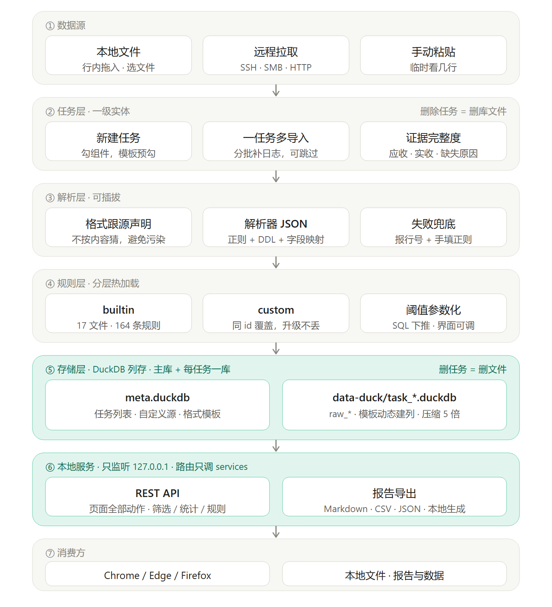

# LogWarden — 项目设计说明（应急响应日志分诊）

> 版本 v0.7-duck ｜ 2026-11-07 ｜ 状态：主版本，存储层为 DuckDB，详见第 8 节
> 本文是项目唯一事实来源。任何功能增删、技术选型变更，先改本文再改代码。

> **版本说明**：本目录（`logview-duck/`）是**主版本**，产品名 **LogWarden**，存储层为 DuckDB。
> `../logview/`（SQLite 版）已于 2026-11-07 冻结存档，仅作对照参考，不再同步功能。
> 两版业务逻辑、界面、规则库、模板体系同源；**只有 `storage.py` 是各自的存储实现**，
> 对外方法签名一一对应，所以 `services/` 和 `app.py` 不感知后端类型。
> 数据落在 `data-duck/task_*.duckdb` 与 `meta.duckdb`，默认端口 **8766**（SQLite 存档版是 8765）。
> 下文除第 8 节存储选型外，与存档版行为一致，同一批日志跑出来的统计、频次、告警结果已逐项比对相同。
> 唯一实现分歧：DuckDB 版把行规则的 `match` 翻译成 SQL 下推执行（`services/sql_rules.py`），
> 因为 RE2 + `count(*) FILTER` 只有 DuckDB 具备；语义必须与 `matches()` 完全等价，
> 翻译不了的规则（lookaround、反向引用、带 params）自动回退 Python。结果已逐条比对一致。

---

## 1. 一句话定位

**本地运行的日志分诊台：导入 → 统计出分布 → 筛掉正常 → 规则标出可疑 → 导出带证据的报告。**

不做采集、不做实时监控、不做威胁情报。它替代「grep + awk + 肉眼滚动」，不替代 Velociraptor 或 Wazuh。

**唯一衡量指标**：从拿到日志到出报告，2 小时压到 30 分钟。

## 2. 三个使用场景

- **A 单站点应急**：`access.log` → 有没有 webshell、从哪来、什么时候
- **B 主机体检**：Linux 疑似失陷 → 谁登录、有无提权、有无持久化
- **C 多源关联**：nginx + Linux + Windows → 攻击链怎么走

## 3. 核心概念

```
任务 Task        一次排查 = 一个事件 / 一个站点 / 一组主机
  └ 导入 Import  任务下的一次数据导入，可多次（分批补日志）
      └ 日志源    这份数据属于哪种类型（nginx_access / auth_log / evtx）

组件 Component   原子的技术栈单元：nginx / Tomcat / MySQL / Windows / Sysmon …
   └ 日志源      一个组件对应一到多条日志
模板 Template    常用组件组合的快捷预设，不是限制
```

任务自带**证据完整度**：应收哪些、实收哪些、缺什么，写进最终报告。

## 4. 功能范围

| 期 | 内容 |
|---|---|
| 一期 | 新建任务 · 本地导入 · 表格视图 · 过滤与正则搜索 · 任务管理 · 本地粘贴解析 |
| 二期 | 统计面板 · 频次与基线 · 树状路径 · 规则引擎 · 导出 CSV |

**一期后端落点**：`POST /api/tasks` 建任务，`POST /api/tasks/{id}/imports` 流式上传并入库，`POST /api/tasks/{id}/query` 参数化查询，`GET /api/tasks/{id}/sources/{source}/stats` 实时统计，规则与告警接口共用同一套规则加载器。上传、解析、查询、统计均不得在路由里写业务逻辑。
| 三期 | 远程拉取：SSH/SFTP · SMB · HTTP(S) | 从另一台机器直接拉日志入库，按块流式，可取消 |
| 四期 | 报告与数据导出（本地 Markdown / CSV / JSON） |

**运行形态：本地服务 + 浏览器打开，不做 MCP、不打包桌面应用。**

`python app.py` 起一个只监听 `127.0.0.1` 的服务，浏览器访问即可用。关闭服务即退出，数据全在本机 DuckDB 文件。目标浏览器：Chrome、Edge、Firefox（主流三家的当前稳定版）；不使用 Chromium 专有 API，不依赖浏览器扩展。

**浏览器兼容基线**：`static/compat.js` 在主脚本前补齐 `closest`、`NodeList.forEach`、`includes`、`padStart/padEnd`、`Object.assign` 等接口，覆盖较旧的 Chromium 内核壳；核心请求使用标准 `fetch` 与 `Promise`。启动器按 Chrome → Edge → Firefox 探测，Edge 同时识别标准 `Edge\Application` 与 `EdgeCore\<版本>` 两种安装位置；某款启动后立即退出时自动尝试下一款。Edge / Chrome 使用 `--headless=new` 做兼容性回归，Firefox 对应标准 DOM API 与独立配置启动。

日常启动双击目录下的 `启动.vbs`：它以 `pythonw.exe` 无窗口拉起 `start.py`，后端控制台隐藏运行，自动选择 Chrome / Edge / Firefox，用项目内独立浏览器配置打开；Chrome / Edge 默认调试端口 `9223`，地址为 `http://127.0.0.1:9223/json/version`。停止服务双击 `停止.vbs`，按 `runtime/server.json` 记录的进程号结束后端，不动浏览器进程。

命令行方式仍可用 `.venv/Scripts/python.exe start.py`，参数 `--browser edge|chrome|firefox|none` 指定行为。`启动.vbs` 支持同样的参数透传，例如 `启动.vbs --browser none` 只起服务不开浏览器。启动失败时 `start.py` 会写 `runtime/last-error.txt` 并在无控制台环境下弹窗提示。

> **远程拉取已实现**，前端不再是原型。三个协议共用 `services/remote.py` 一层抽象：`expand()` 展开通配、`open()` 返回明文字节流、`sample()` 取样估算行数。拉取走后台线程 + job 轮询，导入复用本地导入那条 `Importer.import_stream()` 管道——远端流和本地文件在它眼里没有区别。详见 §5.7。

---

## 5. 核心功能设计

### 5.1 组件选择与日志清单

**新建任务的核心动作是「勾组件」，不是「选架构」。**

真实环境千奇百怪，任何模板都覆盖不全。所以三层结构：

```
组件 Component   原子的：nginx / Tomcat / MySQL / Windows / Sysmon / K8s …
   └ 日志源      一个组件关联一到多条日志（nginx → access.log + error.log）
模板 Template    只是常用组合的快捷方式，本质是「预勾一组组件」
```

**组件库按发行版与安全设备拆分。CentOS 与 Ubuntu 是独立组件、独立日志源，同一任务可同时勾选，条数和证据状态不得合并；安全分组新增防火墙。**

| 分组 | 组件 |
|---|---|
| Web | nginx（含 OpenResty / Caddy / Traefik）· Apache · IIS · Tomcat · WebLogic · JBoss |
| 运行时 | PHP（FPM + 应用）· Spring Boot（应用 + GC + 崩溃） |
| 中间件 | HAProxy · RabbitMQ · Kafka · Elasticsearch |
| Linux | **CentOS 主机 + CentOS auditd**（secure/messages/cron/yum/dnf）· **Ubuntu 主机 + Ubuntu auditd**（auth.log/syslog/CRON/apt/dpkg） |
| Windows | Windows 主机（安全/系统/计划任务/RDP/Defender）· Sysmon · PowerShell |
| 数据库 | MySQL · PostgreSQL · Oracle · SQL Server · Redis · MongoDB · 达梦 · 人大金仓 |
| 容器 | Docker · Kubernetes |
| 安全 | **防火墙（流量会话 / 策略变更 / 管理员登录）** · WAF / 云防护 |

**Linux 发行版在组件与日志源两层拆分**：`centos_*` 与 `ubuntu_*` 使用不同源 ID。解析器可复用 syslog/text，但界面分组、导入归属、统计和证据完整度必须独立。其他发行版后续按同样模式新增，不再混进一个“Linux 主机”。

```json
{ "id": "centos_auth", "paths": ["/var/log/secure"], "format": "syslog" }
{ "id": "ubuntu_auth", "paths": ["/var/log/auth.log"], "format": "syslog" }
```

这样候选路径能一次列全，比给每个发行版做一个组件更实用。

**新建流程**

1. 勾组件（可点模板一键预勾，也可以完全自己选）
2. 组件一勾上，下方立刻列出这些组件的全部日志源：按组件分组，每行给完整名称、必要项/推荐项/可选项标记、默认路径；默认只勾必要项与推荐项，可选项留给人自己决定
3. 默认勾选 `enabled_by_default` 的项，用户可去掉这次不查的（如只要 `secure` + `messages` + `cron`，不要内核和 journald）。提交时以勾选结果作为任务的 `source_ids`
4. 逐个导入，可跳过，后续补。导入入口就在「本任务日志清单」每一行：行左侧虚线框拖入文件/文件夹，行右侧「选择文件导入」开原生对话框——归属在拖下去那一刻就定了，不用再选源。清单只列本任务勾选的源，缺源去「证据清单」抽屉补勾
5. 建完任务直接落到导入页，不留在仪表盘看空图表

**证据清单可反悔**：`PATCH /api/tasks/{id}/sources` 支持任务建好后随时增删源。前端是一个左抽屉（`?evi=1` 可直达），按组件列出该架构下**全部可收集的源**（含未选），勾选即入清单、取消即移出。取消一个已有数据的源要二次确认——**只从清单和切换条隐藏，不删库**，重新勾上原样恢复；最后一个源不允许取消。源列表严格跟勾选走（不再取 `source_ids ∪ 有数据的源` 的并集），否则"取消勾选"就成了假动作；总行数仍按库内存量统计，因为抽屉的「已导入 N 条」提示需要真实数字。

**证据清单以勾选结果为准**：`/api/tasks` 收到的 `source_ids` 必须落在所选组件的源范围内，服务端按这个集合生成 `evidence.logs` 与「已收 / 应收」分母，未勾选的源不出现在清单里也不计入分母。分母再按级别收一层：组件内有必要项时只算必要项，没有必要项才退到推荐项，都没有才退到全部可收集项；`optional` 与 `enabled_by_default=false` 的源不计入分母。接口返回 `basis` 字段（`required` / `recommended` / `all`）说明该组件按哪一级算的分母。

**四条设计约束**

1. **组件可任意组合**。nginx + IIS 同时存在、Linux 和 Windows 混部都很正常，不限制只选一个体系。
2. **模板只是预设，勾完还能改**。不因为选了「Linux 单体 Web」就锁死清单。
3. **`suggested` 组件单独显示为「你可能还需要」**，默认不勾。选了「Linux 单体 Web」但后端是 Java 时，Tomcat 就在这一栏提示。
4. **单个日志源可以在清单里单独取消**。只要 access.log 不要 error.log 是常见需求。

**模板只保留 8 个经典场景**，不追求覆盖全部；日志数不再写死，界面按组件库实时计算：

| 模板 | 预勾组件 | 建议追加 |
|---|---|---|
| Linux 单体 Web | nginx · Ubuntu · MySQL · PHP | WAF · Tomcat · Spring |
| 前后端分离 | nginx · CentOS · Spring · MySQL · Redis | WAF · HAProxy · Tomcat · ES · Kafka |
| Windows 域环境 | Windows · Sysmon · PowerShell · IIS | SQL Server |
| Oracle 业务系统 | nginx · CentOS · WebLogic · Oracle | WAF · HAProxy · Tomcat |
| K8s 容器 | K8s · Docker · Ubuntu · nginx | Redis · ES · Kafka · MySQL |
| CentOS 主机体检 | CentOS · CentOS auditd | 防火墙 |
| Ubuntu 主机体检 | Ubuntu · Ubuntu auditd | 防火墙 |
| 混合环境 | nginx · CentOS · Windows · Sysmon · 防火墙 | IIS · Tomcat · MySQL · Oracle · CentOS auditd · PowerShell |

> 模板的定位是「省事」，不是「限制」。新环境优先自己勾组件。
> 「建议追加」那一栏默认不勾，在界面上以虚线框单独提示。

**选完的架构必须在任务里看得见。** 建完任务就忘掉当时勾了什么，是这类工具最常见的坑——补日志时不知道该补哪份，复盘时说不清"这个结论是基于哪些证据"。所以架构要在任务内三处常显：

| 位置 | 内容 |
|---|---|
| 标题栏副行 | 架构名 + 证据完整度 chip（已收 / 应收） |
| 仪表盘架构条 | 架构名 + 每个组件的 chip（`已收/应收` 份数），收齐的绿底、缺件的黄底 |
| 任务架构与证据面板 | 按组件分组，逐条列出该组件的日志源与状态：绿=已导入（悬浮显示条数与格式）、黄=待导入、灰=默认未开启 |
| 证据清单抽屉 | 右上角按钮打开，列出**该架构下全部可收集的源**（含未选），勾选即增删，两列排布 |

仪表盘那份是「已选清单的完成度」，抽屉那份是「可选项的全集 + 增删入口」——前者回答"还缺什么"，后者回答"还能收什么"。

以上数值**全部实时计算**：条数取实际解析入库的行数，时间范围取所有源的首末记录，收齐度取任务配置的日志清单与实际导入数据的交集，切换条上每个源的条数取该源实际行数。补导日志、删源、切源后自动变，没有任何需要手动维护的统计项。

状态三态是有意区分的：**「待导入」是这次排查缺的证据，「默认未开启」是日志本来就没开**（如 MySQL 慢查询、Tomcat access log）。两者对结论可信度的影响完全不同，混成一个"缺失"会误导。

### 5.2 一个任务多份日志：日志源与视图切换

**问题**：一次入侵排查，一个任务下往往同时有 nginx access、auth.log、Security.evtx 三四份日志。字段完全不同——一个讲 HTTP 请求，一个讲登录，一个讲进程创建——不能塞进同一张表，也不能共用同一套统计。

**日志源 Source 是视图的最小单位。** 任务 → 多次导入 → 每次导入绑定一个日志源类型；日志源决定字段集、统计维度、检测套件。

| 源类型 | 字段 | 统计维度 | 专用检测 |
|---|---|---|---|
| web_access（nginx / Apache / IIS / Tomcat） | ts · ip · method · path · ua · status · bytes · ref | 来源 IP · 路径 · UA · Referer · 状态码 · 方法 | webshell 命令执行 · 数据外带 · 路径体积突变 |
| centos_auth / ubuntu_auth（secure / auth.log） | ts · host · proc · pid · user · srcip · result · msg | 来源 IP · 账号 · 进程 · 结果 · 主机 | SSH 爆破 · 异常时段登录 · sudo 提权 · 账号新增 |
| centos_syslog / ubuntu_syslog（messages / syslog） | ts · host · proc · level · msg | 进程 · 级别 · 主机 | 计划任务下载执行 · 新增服务 · SYN 洪泛 · 访问被拒 |
| centos_audit / ubuntu_audit（auditd） | ts · host · type · key · comm · exe · msg | 记录类型 · 审计键 · 命令 · 主机 | 敏感文件访问 · 账号变更 · 远程下载 · 计划任务写入 |
| centos_history / ubuntu_history（bash_history） | ts · host · user · source · cmd | 账号 · 来源 · 主机 | 下载即执行 · 反弹 shell · SSH 公钥后门 · 清理痕迹 |
| win_security（evtx 4624/4625/4688/4720） | ts · host · eventId · level · user · srcip · logonType · msg（另存 `event` 中文名） | 账号 · 事件 ID · 来源 IP · 级别 · 主机 | 登录失败激增 · 新建账号 · 可疑命令行 · 特权登录 |
| win_powershell（PowerShell/Operational 4104） | ts · host · user · kind · text | 脚本类型 · 账号 · 主机 | 脚本下载执行 · Base64 编码 · 凭据窃取 · 横向移动 · 持久化 |
| win_sysmon（Sysmon/Operational 1/3/11/13/22） | ts · eventId · event · host · image · cmdline · target · user | 事件类型 · 进程 · 主机 · 账号 | Web 进程拉起子进程 · 外联外网 · 可执行落地 · 自启动项 · 可疑 DNS |
| firewall_traffic / firewall_system | ts · host · vendor · action · protocol · srcip · srcport · dstip · dstport · rule · msg | 来源 IP · 动作 · 目的 IP · 协议 · 策略 · 主机 | 管理端口暴露 · 策略变更 · 管理员登录失败 |
| 通用文本（应用 / syslog） | ts · host · proc · level · msg | 进程 · 级别 · 消息模板 · 主机 | 错误突增 · 消息模板首次出现 |

**Windows 必须拆成三个源，不能合成一个。** Security 讲的是"谁登录了、建了什么账号"，Sysmon 讲的是"哪个进程拉起了谁、连了哪、写了什么文件"，PowerShell 4104 讲的是"执行了什么脚本"。三者的字段数量差一个量级（Sysmon 事件 1 有 20+ 字段，4104 的正文是一整段脚本），强行对齐字段只会互相污染。拆开后各自的检测套件才有意义：账号侧看 4625 激增，进程侧看 w3wp 拉起 cmd，脚本侧看 `DownloadString` 与 Base64。

**Linux 同理，四个源各管一段。** `auth.log` 只看认证（谁登进来了），`syslog` 看内核与服务状态（服务起没起、有没有 SYN 洪泛），`auditd` 看命令执行与文件访问（相当于 Linux 的 Sysmon），`bash_history` + `crontab` 看人敲了什么、留了什么定时任务。四个源的时间戳能串成一条链：auth 里的爆破 → auditd 里的 `curl` 落地 → shell 里的 `bash x.sh` → syslog 里的新服务启动。

**发行版差异只共用解析器，不共用源定义**：CentOS 用 `centos_auth`（secure）+ `centos_syslog`（messages），Ubuntu 用 `ubuntu_auth`（auth.log）+ `ubuntu_syslog`（syslog）；auditd、bash_history、包管理与登录导出同样按 `centos_*` / `ubuntu_*` 分开。切换条按 CentOS、Ubuntu 分组显示，字段解析与规则套件可以复用。

**界面**：标题栏下常驻一条「日志源」切换条。**默认只列有数据的源**，没有数据的收成「+ N 待导入」一个按钮，点它才展开全部；当前源本身为空时（刚建任务）自动展开，点收起会自动跳到第一个有数据的源，不让台面全空。按钮上只写文件名（`secure` / `messages` / `auth.log` / `syslog` / `cron`），发行版靠分组标签 `CentOS` / `Ubuntu` 区分，完整名称与路径进 `title`。切换后同时变四样：表头列、筛选控件、统计维度、检测卡片。当前源高亮、条数常显。

**为什么不一上来就铺全部源**：一个 CentOS 组件挂着 8 个源，建完任务全是 0，铺一排 0 只会让人不知道先导哪个。先给有数据的，剩下的收成一行入口，数量自己会说话。

**统计随源生成，不写死**：概览卡片、排行维度按钮、明细表，全部按当前源的 `dims` 渲染。web 源看到「状态码分布 / 路径排行」，auth 源自动变成「结果分布 / 账号排行」，同一套渲染代码。

**列配置按源独立记忆**（`logview.cols.v4.<sourceId>`）：nginx 的列顺序不会污染 auth.log。

**规则按源适用**：每条规则声明 `applies_to: [源类型]`，切到 auth 源时不显示只适用于 HTTP 的规则。

**明确不做**：不做跨源字段强行对齐（把 auth 的"账号"塞进 path 列），不做跨源 JOIN。多源关联留给报告阶段，由 AI 读多份统计结果自行串联。

### 5.3 统计

四类，全部后端 SQL 计算。

**A 概览**：总条数、时间跨度、独立 IP/路径数、状态码分布、每小时请求量

**B 排行**：IP / 路径 / UA / Referer / 状态码 / 方法。**不设条数上限**，全量按次数（或字节）从高到低列出，前端滚动区展示，标题旁标注总项数。排序可切「次数」或「字节」——两者结论常不同（扫描器次数多流量小，外带次数少流量大）。

**C 频次分析**（规则引擎做不出来的，必须用窗口函数）

```sql
SELECT ip, ts, COUNT(*) OVER (
  PARTITION BY ip ORDER BY ts RANGE BETWEEN 60 PRECEDING AND CURRENT ROW
) AS cnt FROM v_web WHERE task_id = ?
```

判据：60 秒 > 100 次且路径 > 20 → 目录扫描；集中在单一登录接口 → 爆破。

**D 基线分析**（找 webshell 与数据外带）

按 `path` 算 `count / avg_bytes / p95`：
- 平时 30KB，突然出现 100 字节的 200 响应 → 命令执行结果
- 平时不存在的路径突然大量 200 且体积大 → 数据外带

**表格列宽**：统计页六张表一律内容自适应（`table-layout:auto`），不写死 px；长文本列（路径 / UA）封顶 360px 后省略，其余列按内容宽度；内容总宽超出卡片时在卡片内横向滚动，不裁列。

### 5.4 筛选与搜索

条件是一个 JSON，前端拼装，后端翻译成 SQL。

```json
{
  "time":   { "from": "...", "to": "..." },
  "fields": { "ip": ["10.20.31.15"], "status": [200, 500] },
  "text":   { "path": "upload" },
  "regex":  { "path": "\\.(php|jsp)$" },
  "range":  { "bytes": { "gte": 0, "lte": 200 } },
  "exclude": { "static": true, "status": [404], "ua": ["Zabbix", "kube-probe"] }
}
```

硬要求：
1. **排除项做成开关**（静态文件 / 404 / 30x / 监控探针），占实际动作的 90%
2. **正则只在后端跑**
3. **条件可保存为视图**，下次直接调出
4. **分页用游标**（`WHERE rowid > ? LIMIT 200`），不用 OFFSET
5. 显示过滤前后条数
6. **列可配置**：显示哪几列、列的先后、每列宽度全部由用户决定，配置存浏览器本地（`logview.cols.v5.<源 id>`），每个日志源独立记忆。默认顺序为 时间 → 来源 IP → 方法 → 路径 → **User-Agent** → 状态 → 大小 → 标记，Referer 默认隐藏。UA 排在第 5 列，紧跟"请求了什么"之后——先看谁、再看要什么、最后看用什么客户端，符合排查时从上到下的阅读顺序。

7. **列宽默认由内容决定，不写死像素**：表格 `table-layout:auto` + `width:max-content/min-width:100%`，浏览器按每列内容排布。**列宽只由内容算，筛选控件不参与**（控件绝对定位），否则"全部"这类占位文案会把列撑变形。超长列给上限，超出用省略号并在 `title` 里留全文：路径 440px、命令行 340px、UA 330px、消息 360px、目标 255px、进程 170px。其中**命令行、UA、消息三列允许换行**（`word-break:break-word`），因为这三类内容的完整形态必须能看见——截断的 `-enc SQBFAFgA…` 等于没看到。容器装不下时整表横向滚动，不压缩列。

8. **手动列宽是显式降级**：拖动表头分隔线或双击自适应，会把当前各列渲染宽度固化进配置并切到 `manual` 模式（`table-layout:fixed`）。字段面板里有「列宽自适应」按钮回到内容驱动。这条约束是为了避免"半自动"状态：要么全按内容，要么全按用户定的数。

9. **每列表头一个漏斗，点开是 Excel 式筛选面板**。表头右侧常驻一个很小的漏斗按钮，点开浮层：

   - 顶部：**升序 / 降序**（按该列排序，表头显示 ↑ / ↓）
   - 标签页：**按选项 / 按条件**
   - 按选项：搜索框 + 全选 / 全不选 / 反选 + 带计数的复选框列表（值按出现次数降序），右上角显示「已选 N / M」
   - 按条件：时间列给**起止两个输入框**（支持 `09:00`、`11-04 09:00`、`2026-11-04 09:00`，只填时分按当日时刻比较）；其他列给「包含文字」
   - 底部：清除筛选 / 取消 / 确定

   **必须点「确定」才生效**，这是刻意跟 Excel 保持一致——勾一半就重算表格，用户没法连续勾选多个值。有筛选的列，漏斗变实心高亮；鼠标悬停显示当前筛选摘要（如"已筛选：5 个值"）。

   **时间列默认停在「按条件」**，因为时间点几乎没有重复值，按选项列出来等于列全部行。

   不做即时筛选还有个副作用要考虑：顶部工具条的快捷筛选（状态码大类、排除静态文件）仍是即时生效的，两套入口共存，用户改完工具条会立刻看到结果，改完列面板要点确定。这个差异在界面上用「漏斗是否高亮」来区分。

10. **单元格单击即复制**：点任意格子把内容写进剪贴板并弹提示，拖选文字时让位于原生选择（有选区就不抢）。优先 `execCommand`（同步、`file://` 下可用），失败回退 Clipboard API，两条路都没响应则提示手动复制——不给"点了没反应"的死角。

11. **表头吸顶**：日志区自带滚动容器（`#logWrap`，高度 `100vh - 262px`），表头 `sticky top:0`。筛选改成浮层后，表头只剩一行，不再需要维护第二行的偏移量。

### 5.5 报告与导出（本地生成，不走 MCP）

**MCP 通道取消。** 单人使用场景下，报告最终是粘进工单、邮件或文档，中间绕一层 AI 只会多一个故障点，还要维护协议、鉴权与工具描述。直接在本机生成更快。

报告在界面里组装，用户可选中要包含的章节：

| 章节 | 数据来源 |
|---|---|
| 结论摘要 | 规则命中 + 检测套件结果 |
| 时间线 | 关键事件按时间排序（跨源合并） |
| IOC 清单 | 攻击 IP、webshell 路径、可疑域名、落地文件 |
| 证据完整度 | 应收 / 实收 / 缺失原因 |
| 统计附录 | 各源排行与频次分析结果 |

导出格式：**Markdown**（主）、CSV（单表数据）、JSON（完整结构化数据，便于二次处理）。不做 docx 模板——排版交给用户自己的 WPS/Word。

### 5.6 规则引擎

**成败在误报控制，不在规则数量。** 规则一多、误报一高，用户看两眼就不信了，整个告警面板作废。

#### 规则类型

| 类型 | 判定 | 执行 |
|---|---|---|
| `row` | 单条日志字段满足条件 | 导入完成后批量跑 |
| `aggregate` | 需 GROUP BY / 窗口函数 | 手动触发或统计时跑 |

#### 规则文件组织（分层 + 覆盖）

```
rules/
├── builtin/                    随程序发布，按类别拆文件
│   ├── webshell.json           3   WebShell 访问、极短响应、体积突变
│   ├── scanner.json            3   扫描器 UA、UA 异常、单 IP 爆发
│   ├── injection.json          4   SQL/命令注入、文件包含、路径穿越
│   ├── recon.json              2   敏感文件探测、后台探测
│   ├── web-attack.json        17   备份泄露、反序列化、JNDI、OGNL、SSRF、接口暴露、上传执行
│   ├── host.json               4   认证爆发、账号创建、日志清除、计划任务
│   ├── linux-host.json        18   反弹 Shell、下载执行、公钥后门、挖矿、Rootkit、审计规避
│   ├── windows-auth.json      20   登录、账号、服务安装、日志清除、Kerberos、时间篡改
│   ├── windows-sysmon.json    20   进程链、落地、自启动、外联、DNS、凭据、横向移动
│   ├── windows-powershell.json 8   编码执行、下载、AMSI、反弹连接、令牌提权
│   ├── app-log.json           12   数据库报错/提权/Redis、反序列化异常、K8s 与容器
│   └── firewall.json           8   管理口、公网暴露、全通策略、外联可疑端口
└── custom/                     用户自定义，不进版本库
```

**加载规则**：
1. 读 `builtin/*.json` 全部条目
2. 读 `custom/*.json`，**同 id 覆盖内置**
3. 按文件 mtime 缓存，改动后自动重载（不用重启）
4. 加载失败只跳过该文件并记日志，不影响其他规则

**这条"同 id 覆盖"是关键**：内置规则参数不合适，复制到 `custom/` 改阈值即可，不用改程序目录，升级时也不会被覆盖。

#### 规则结构

```json
{
  "id": "ws_tiny_response",
  "name": "脚本返回极短内容",
  "severity": "high",
  "kind": "row",
  "scope": "web",
  "params": { "max_bytes": 200 },
  "match": {
    "path":   { "regex": "\\.(php|jsp|aspx)$" },
    "status": { "eq": 200 },
    "bytes":  { "lt": { "param": "max_bytes" } }
  },
  "explain": "脚本返回极短内容，符合一句话木马执行命令后的返回特征",
  "false_positive": "心跳接口、探活接口也会返回极短内容",
  "tags": ["执行"],
  "enabled": true
}
```

**`params` 让阈值可调**：界面上把 `max_bytes` 渲染成输入框，60 秒改成 30 秒、100 次改成 50 次都不用改文件。这是"写活"的核心——规则不是一个死字符串，而是一个带参数的判断。

**`scope` 写日志源类型，不写具体源 id**：`web` / `auth` / `syslog` / `audit` / `shell` / `win` / `ps` / `sysmon` / `firewall` / `text`；一条规则要覆盖多类时写数组，比如 Linux 规则写成 `["auth","syslog","shell","audit"]`，同一条正则对四类日志都生效。`scope` 用 `"all"` 会串源误报，已在决策 27 禁用。

**匹配字段来自解析器 `fields`**：规则只能引用该日志源真实存在的列（web 是 `path`/`status`/`ua`，Windows 是 `eventId`/`cmdline`/`image`，Sysmon 是 `parent`/`target`）。所有表都额外返回 `raw`（原始行），跨源通用的规则优先用它，避免为每个源写一份。字段名写错不会报错，只会静默不命中——所以每条规则都要有样本兜底。

#### 匹配操作符

| 类别 | 操作符 |
|---|---|
| 比较 | `eq` `ne` `gt` `gte` `lt` `lte` |
| 集合 | `in` `not_in` |
| 文本 | `contains` `icontains` `contains_any` `icontains_any` `starts_with` `ends_with` |
| 正则 | `regex` `iregex` `not_regex` |
| 长度 | `len_lt` `len_gt` `len_eq` |
| 存在性 | `exists` `not_exists` |

顶层字段之间默认 AND；需要 OR 时用 `{ "any": [ ... ] }`，需要取反用 `{ "not": { ... } }`。

#### 聚合规则类型

`ip_burst`（单 IP 爆发）· `path_baseline_shift`（路径体积突变）· `auth_fail_burst`（认证失败爆发）· `window_count`（通用滑动窗口计数，支持不同账号/路径/端口/主机数）· `fail_then_success`（同源连续失败后成功）。后两类使用真实滑动窗口，不按固定分钟切块；空来源与 `-` 不参与分组。

#### 内置规则（当前 160 条、启用 155 条，覆盖 10 类日志源）

| 文件 | 规则 |
|---|---|
| webshell | 脚本被访问 · 返回极短 · 体积突变 |
| scanner | 已知扫描器 UA · UA 异常 · 单 IP 爆发 |
| injection | SQL 注入 · 命令注入 · 文件包含 · 路径穿越 |
| recon | 敏感文件探测 · 后台探测 |
| web-attack | 敏感文件成功读取 · 备份下载 · 命令执行参数 · 代码执行函数 · 包含系统文件 · 反序列化 · JNDI · OGNL · SSRF · 管理接口暴露 · 上传目录脚本 · WebShell 命名 · 异常方法 · 大文件下载 · 空字节编码 · 脚本工具 UA · 上传提交 |
| host | 认证失败爆发 · 账号创建 · 日志清除 · 计划任务写入 |
| linux-host | 反弹 Shell · 下载即执行 · 公钥后门 · 挖矿 · 内核模块 · 关闭防护 · 清历史 · sudo/su 提权 · chattr · 改账号文件 · 临时目录投放 · 进程伪装 · 审计临时执行 · 审计规则清空 · Redis 未授权 · 数据库 root 直连 · 特权容器 |
| windows-auth | 4625 失败 · 4624 外网成功 · 4648 显式凭据 · 4672 特权 · 4688 可疑命令行 · 4720 建号 · 4728/4732/4756 加组 · 4722 启用 · 4724 重置密码 · 4726 删除 · 1102 清日志 · 4719 审计变更 · 7045 装服务 · 6006 日志服务停止 · 4624 类型 10 · 4740 锁定 · 4769 弱加密 · 4616 改时间 · 4698 计划任务 · 5145 共享访问 |
| windows-sysmon | Web/Office 子进程 · 脚本宿主 · 编码命令 · 命令行下载 · 临时目录落地 · Run 键 · 服务注册表 · 脚本外联 · 可疑 TLD · lsass 访问 · 注入与篡改 · 删卷影 · 关 Defender · 凭据导出 · 横向工具 · schtasks · WMI 订阅 · 改文件时间 · 备用数据流 |
| windows-powershell | Base64 解码执行 · 下载 cradle · 隐藏窗口 · AMSI 绕过 · 凭据读取 · 反弹连接 · 令牌提权 · 动态执行 |
| app-log | SQL 语法报错 · 数据库认证失败 · UDF/xp_cmdshell 提权 · Redis 危险配置 · 慢查询注入 · 反序列化异常 · JNDI 加载 · OGNL 异常 · XXE 异常 · K8s exec · 读 Secret · 挂 docker.sock |
| firewall | 管理端口放行 · 公网直连管理口 · 管理口被拒 · 外联可疑端口 · 全通策略 · 配置清空 · 策略变更 · 管理员认证失败 |
| web-advanced | JNDI 混淆 · XSS · SSTI · XXE · 双扩展名 · GraphQL 内省 · 编码路径穿越 · Gateway 路由修改 |
| windows-advanced | 远程共享服务 · BITS 下载 · mshta/regsvr32/rundll32 代理执行 · WMI 远程进程 · 权限分配 · 目录对象修改 · RC4 票据 · 启动目录落地 · .NET 编译 · Defender 注册表 |
| linux-advanced | systemd · Shell 启动脚本 · at/cron · LD_PRELOAD · shadow 读取 · Base64 解码执行 · /dev/shm · 计划任务下载回连 |
| database-advanced | INTO OUTFILE · xp_cmdshell · PostgreSQL PROGRAM · Redis SSH 公钥 · MongoDB 服务端 JavaScript |
| correlation | 批量 404 · Web 登录失败 · SSH/Windows 密码喷洒 · 端口/主机扫描 · SSH/Windows 连续失败后成功 |

**规则必须配命中样本**：`tests/test_rules.py` 为每条 row 规则准备一条样本，断言 `matches()` 为真。好处是正则写错当场暴露，而不是上线后整条规则静默失效——「规则存在但永远不命中」比「没有这条规则」更危险，因为面板上会显示 0 命中，让人误以为环境干净。聚合规则无法用单行样本验证，单独列在 `AGGREGATE_RULES` 里；`window_count` 与 `fail_then_success` 另外用合成事件序列验证窗口、不同值计数、成功序列和窗口外反例。`tests/test_rule_contract.py` 再检查重复 ID、适用范围、每个目标解析器的字段、ATT&CK 编号与参考链接，防止规则能加载却永远不会命中。

#### 误报控制四措施

1. **强制 `false_positive`**，内置规则也要填。没有它，用户不知道命中意味着什么
2. **试跑**：新规则先跑一遍，命中率 > 总量 5% 时提示"该规则不适用本任务"
3. **白名单**：按 IP / 路径 / UA / 规则 id 排除，任务级生效
4. **告警可回原文**：`alert.row_id` 指回原始行，点击跳转并高亮

#### 规则管理界面

**一条规则一张卡片**，不按 category 分块——分组容易让人以为同组规则是一起开关的，实际每条独立。

卡片内容：勾选框 · 级别色点 · 名称 · 级别标签 · 优先级 · 内置/自定义标记 · 启用开关 · 编辑 · 删除；下面依次是说明（含误报提示）、ATT&CK 技术编号、命中后排查建议、参考来源、只读的模式代码块、分类与适用源。技术编号可点击到 MITRE ATT&CK 对应页面，搜索框同时检索技术编号与排查建议。

顶部工具条：搜索（名称 + 说明 + 模式全文）· 分类下拉 · 级别下拉 · 仅显示启用 · 规则测试 / 导入 / 导出 / 新建 / 重置。

**批量操作**：勾选任意一条后浮出批量条（已选 N 条 · 批量启用 / 禁用 / 删除）。全选只作用于**当前筛选结果**，否则「筛完再全选」会把看不见的规则一起删掉。

**编辑边界**：
- 自定义规则：名称、分类、级别、优先级、适用源、匹配字段、正则、说明全可改
- 内置规则：逻辑写在代码里，只能改名称 / 级别 / 优先级 / 说明 / 启用；正则框置灰并写明原因，不做成「能点但点了没反应」

**删除是两步**：点 ✕ 变成「确认」，2.6 秒内再点才执行，超时自动复原。不用 `confirm()`——原生弹窗在 `file://` 下体验差，还会打断连续操作。

**持久化**：内置规则的匹配逻辑是函数，没法序列化。本地只存三样：`edited`（元信息覆写）、`custom`（自定义规则整条）、`deleted`（被删的内置 id）。刷新后逻辑仍来自代码，改动照样生效。键名 `logview.rules.v1`。

**规则测试**：选日志源 + 粘一段文本，列出命中与未命中。样本只有文本，其余字段（`status` / `bytes` / `eventId`）给一组典型值——否则依赖这些字段的规则永远测不出命中，人会以为规则坏了。

**新建规则用正则**，可选匹配字段（整行拼接 / path / msg / ua / target / image / cmdline / text / cmd）。保存前校验正则语法，错误直接报出来。

#### 威胁分析页与规则管理必须同源

这两页读的是**同一份生效规则**（`workRules()` 过滤 `enabled` 与当前日志源 `applies`），不允许各算各的：

- 规则管理里禁用一条 → 威胁分析页立刻少一块，侧栏「威胁分析」徽标数字同步下降
- 新增自定义规则 → 威胁分析页出现该规则（命中 0 也列出来，因为"这条规则在你的数据上没有命中"本身就是信息）
- 每次切到威胁分析页都重算，不缓存。规则改动后不重进页面也能看到数字变化

页面顶部一条汇总：生效规则数 · 命中总数 · 有命中的规则数 · 高危/中危分布 · 「去规则管理 →」。

规则按**命中数降序**排，不按优先级——排查时先看最吵的那条。命中 0 的规则排在最后，命中数标签改成灰色，避免一片红色数字造成"处处告警"的错觉。

每块规则头右侧有「规则」按钮，直接跳到规则管理并打开该条的编辑弹窗；每条命中行的「查看 →」跳回日志浏览页并按该条内容搜出对应行。**告警不能是死链**——点了没反应等于让人回去手动翻日志。

### 5.7 远程拉取

本地导入要求文件先在盘上。真实排查里日志在服务器上，来回 scp 一遍既慢又容易漏掉轮转文件——远程拉取就是把这个动作并进来：填主机、路径，直接入库。

**三个协议，一套抽象。** `services/remote.py` 定义 `RemoteFS` 四个方法，三个实现各管一段：

| 方法 | 作用 | SFTP | SMB | HTTP |
|---|---|---|---|---|
| `expand(pattern)` | 通配展开成文件清单，含大小与 mtime | `listdir_attr` + fnmatch | `scandir(search_pattern)` | 不支持通配，`HEAD` 取单个 |
| `open_raw(path)` | 打开原始字节流 | `SFTPFile` + `prefetch()` | `smbclient.open_file` | `urlopen` 流式响应 |
| `sample(path)` | 取头部 256 KB 估行数与预览 | 读 256 KB | 同左 | `Range: bytes=0-262143` |

`RemoteFS.open()` 在 `open_raw()` 外面套一层：`.gz` 自动解压，调用方拿到的永远是明文。这样上层的 `ConcatStream` 和 `Importer` 都不需要知道远端是压缩的还是明文的。

**为什么 SFTP 一定要 `prefetch()`。** paramiko 的 `SFTPFile` 默认每次 `read` 只发一个 32 KB 的请求，拉 1 GB 就是三万多次往返；按 20 ms RTT 算要十分钟，时间全花在等网络上。`prefetch()` 让它在后台并发预取，吞吐能顶到带宽上限。

**探测先于拉取。** 「测试连通」做四件事：连上去、展开通配、读一段样本、估算行数。返回 `files / total_size / est_lines / sample`。这一步的意义是让人在拉之前知道**要拉多少**——50 GB 的 `messages` 和 3 MB 的 `access.log` 处理方式完全不同。行数按样本的平均行长推算，压缩文件用样本的压缩比折算，只求数量级。

**拉取流程。**

```
POST /api/remote/pull  →  job_id（立刻返回）
                            │
        后台线程 ────────────┘
          ├─ open_fs(spec)              建连接
          ├─ expand(path)               展开成 files[]
          ├─ ConcatStream(files)        N 个文件接成一个流
          └─ Importer.import_stream()   复用本地导入管道
                                          │
GET /api/remote/jobs/{id}  ←──────────────┘  前端 400ms 轮询
```

`ConcatStream` 是这条链路的关键：它是一个 `io.RawIOBase`，按需打开第 N 个文件、读完关掉再开下一个，内存里只有一个 64 KB 缓冲。它还实现了 `seek(0)`——`Importer._peek()` 读完文件头要复位，复位时把已读的头部字节回吐（上限 64 KB），不用重连远端。

**凭据与安全。** 密码和私钥只在请求体里出现一次，不进 localStorage、不写配置文件、不进日志。连接成功后进程内留一份供「复用现有会话」用，重启即失。SSH 做 TOFU 指纹校验：第一次连记下指纹，同一 `host:port` 第二次指纹变了就断开并报错——挡住中间人，又不强迫用户先手工 `ssh-keyscan`。私钥支持 RSA / ECDSA / Ed25519，可以直接粘贴文本，不必先在盘上放文件。

**取消。** 取消标志由 `ConcatStream` 每次读时检查，抛 `Cancelled` 打断 `import_stream()`。已经 `commit` 的批次会留在库里——导入本身是分批提交的，不可能回滚到零。界面明确提示「已取消，已提交的批次留在库里，可在导入记录里删除」，比假装干净更诚实。

**边界。** HTTP 不支持通配（没有目录索引协议）；SMB 需要 UNC 或盘符路径，`/var/log/...` 这种 POSIX 写法在 SMB 下没有意义；并发拉取靠进程内写锁串行，一次只允许一个任务写库。

### 5.8 AI 操盘通道与 Skill 手册

**为什么把它当一等需求。** 应急响应现场的瓶颈不是"能不能查"，而是"人知道该查什么"。一个熟悉 Windows 攻击链的分析师能在十分钟内定位横向移动痕迹，换个人可能要两小时——差别全在脑子里的那份检查清单。这份清单原本只存在于人脑和散落的笔记里，换人、换班、隔三个月都接不上。

所以本项目的目标不是做一个更聪明的界面，而是**把这份清单变成机器能读、能复现的东西**：证据清单是结构化数据（组件 → 应收日志 → 缺失项），规则是带 `false_positive` 和 `triage` 的 JSON，每条告警都能指回原始行的 `id`。这样 AI 接手时不需要猜，人核查时也不需要信。

**三条通道，按确定性排序。** 优先级不是性能排序，是**不确定性排序**：

| 序 | 通道 | 不确定性来源 | 适用 |
|---|---|---|---|
| 1 | HTTP API | 无——请求原子，返回即结果 | 建任务、导日志、查统计、读告警、改规则、改模板 |
| 2 | CDP | DOM 与渲染时序 | 需要人同步看到界面过程，或验收前端行为 |
| 3 | 直接读库 | 无 API 语义，要自己拼 SQL | 服务未启动时的离线分析、批量取证 |

模拟点击排最后，是因为它的失败模式最隐蔽：动画、懒加载、缓存状态、焦点竞争，任何一个都能让 agent 以为点成功了而实际没有。API 调用失败会返回错误码，点击失败只会让 agent 继续往下走。

**两条设计约束，反过来约束功能开发。** 这两条不是"顺便支持"，是加了就必须一直守的规矩：

- **每个界面状态必须有直达 URL**：`?nt=1&sel=nginx` 弹新建任务、`?evi=1` 开证据抽屉、`?pg=alerts` 到威胁分析、`#<task_id>` 切任务。新增任何面板或弹窗，都要能被 URL 唤起，否则 AI 只能靠点击序列到达，而点击序列是最脆的一环；
- **规则与模板必须落盘为可读写 JSON**：一旦某项能力只能通过界面改，AI 就失去了对它的控制权。目前 164 条规则、31 个格式模板、自定义源全部是磁盘文件，改完重启或热载即生效。

**Skill 手册为什么放在仓库里。** `skills/logwarden/SKILL.md` 不是外部 wiki，而是与代码同仓、同版本演进的操作手册。理由很直接：**文档和接口一旦分家，先腐坏的一定是文档**。手册里写的是 API 清单、模板 JSON 结构、规则 `match` 语法（只有 `any` / `not`，**没有 `all`**，AND 靠字段平铺）、`scope` 十个取值、`false_positive` 必填、severity 三档，以及六个实际踩过的坑（`filters` 参数不存在、`INTEGER` 在 DuckDB 是 32 位、`executemany` 慢 200 倍等）。

这份手册的内容全部来自实跑验证——28 项接口断言逐条打过后才写进去，不是照着代码想象的。它面向的不是人，是**下一个接手的 AI agent**：读完这 344 行，不用读 6000 行代码就能正确操盘。

**代价。** 这套设计牺牲了一点：界面不能随便改结构，URL 语义和 JSON schema 事实上成了对外契约。改动成本比"随手改个面板"高，但换来的是自动化脚本不会因为你调了一次布局而全部失效。

---

## 6. 存储设计

### 6.1 分库策略：主库 + 每任务一库

```
logview/
├── meta.db                  任务列表、规则覆盖记录、白名单、保存的视图
└── data/
    ├── task_a3f2e1.db       任务 A 的全部原始数据与告警
    └── task_7c9b45.db       任务 B
```

**为什么分库，决定性理由是删除。** SQLite 的 `DELETE` 不会缩小文件，必须 `VACUUM`，而 VACUUM 要重建整个库——5 GB 的库几十秒到几分钟，期间锁库。分库之后删除就是 `os.remove()`，毫秒级且真正擦除。

附带好处：单任务可打包成 `.db` 归档送人；新任务不受历史数据拖慢。

`meta.db` 只存小数据（几十 KB），**必须单独备份**，丢了数据文件就成了无名文件。

### 6.2 任务库：按需建表

**不预建全部表**，导入哪种格式就建哪张，`CREATE TABLE IF NOT EXISTS`。

**表名按格式，不按产品**：

| 表 | 覆盖 |
|---|---|
| `raw_combined` | nginx、apache、Caddy、Traefik（combined 及变体） |
| `raw_w3c` | IIS W3C |
| `raw_tomcat` | Tomcat AccessLogValve |
| `raw_syslog` | auth.log / secure / messages / journald |
| `raw_evtx` | Windows 事件日志（二期） |

以后遇到同样输出 combined 的服务，**不建表、不改视图、不改代码**，直接导入。

### 6.3 表结构

```sql
CREATE TABLE raw_combined (
  id INTEGER PRIMARY KEY AUTOINCREMENT,
  task_id TEXT NOT NULL, import_id TEXT NOT NULL,
  line_no INTEGER NOT NULL, raw TEXT NOT NULL,
  ts INTEGER,                     -- UTC Unix 毫秒；展示时区由前端转换
  ip TEXT, method TEXT, path TEXT,
  status INTEGER, bytes INTEGER,  -- 统一语义：不含响应头
  ua TEXT, referer TEXT, source TEXT
);
CREATE INDEX idx_comb_task_ts ON raw_combined(task_id, ts);
CREATE INDEX idx_comb_task_ip ON raw_combined(task_id, ip);

CREATE TABLE alert (
  id INTEGER PRIMARY KEY AUTOINCREMENT,
  task_id TEXT NOT NULL, rule_id TEXT NOT NULL,
  raw_table TEXT, row_id INTEGER,
  ts INTEGER, matched TEXT, created_at TEXT
);

CREATE TABLE schema_info (version INTEGER NOT NULL, created_at TEXT);
```

**DDL 放在解析器配置里**，`parsers/combined.json` 同时包含建表语句、正则、字段映射。加一种格式 = 加一个 JSON，不碰代码。

### 6.4 视图必须动态重建

`v_web` 要 UNION 多张表，表不存在会创建失败。每次导入后按现有表重建：

```python
tables = [r[0] for r in conn.execute(
    "SELECT name FROM sqlite_master WHERE type='table' AND name LIKE 'raw_%'")]
conn.execute("DROP VIEW IF EXISTS v_web")
conn.execute(f"CREATE VIEW v_web AS {build_union(tables)}")
```

`sqlite_master` 就是表清单，不需要额外维护元数据。

**查询层统一处理"表不存在"**：返回空集，不报错。老任务遇到新格式日志时，界面显示"本任务无此类日志"，而不是抛异常。

### 6.5 删除与归档

| 操作 | 行为 |
|---|---|
| 删除任务（软） | `meta.db` 中 `status='deleted'`，文件保留 |
| 彻底删除 | 删 `data/task_*.db` 文件，删 meta 记录 |
| 归档 | 复制 `.db` 到归档目录，meta 中标 `archived` |

不做 VACUUM——分库方案下不需要。

---

## 7. 目录结构

```
logview/
├── DESIGN.md
├── docs/
│   ├── architecture.svg       架构图源文件（唯一来源）
│   ├── architecture.png       渲染产物，DESIGN.md 引用的就是它
│   └── render.sh              改完 SVG 后重渲染
├── app.py                  FastAPI 入口
├── storage.py              数据库唯一出口
├── meta.db
├── data/                   task_*.db
├── parsers/                combined.json / w3c.json / tomcat.json / syslog.json
├── rules/
│   ├── builtin/            webshell / scanner / injection / recon / host
│   └── custom/             用户自定义，覆盖内置
├── templates/              catalog.json（组件库 + 日志源库）+ 7 个场景模板
├── services/
│   ├── importer.py  query.py  aggregate.py  rule_engine.py  report.py
├── static/                 index.html / app.js / style.css
└── tools/                  运维脚本（备份 meta、跨任务查 IP）
```

## 8. 技术选型

| 项 | 选择 | 理由 |
|---|---|---|
| 语言 | Python 3.11+ | 能力匹配 |
| 框架 | FastAPI | 异步、自带文档、单文件起服务即可 |
| 存储 | DuckDB（分库） | 列存 + 向量化聚合，5000 万行查询亚秒级；删除任务即删文件 |
| 前端 | 原生 HTML + JS | 不引构建链 |
| 表格 | 服务端分页 + 游标 | 避开全量渲染 |

本机实测（5000 万行 nginx access，8 线程）：SQLite 版聚合查询 22–55 秒、库 14.9 GB；DuckDB 版全部查询 0.1 秒内、库 2.7 GB。
代价是 DuckDB **同一库文件只允许一个进程可写**，所以不能起多 worker；本地单用户场景不受影响。
所有 SQL 收在 `storage.py`，两版通过同一组方法签名并存，切换只改启动哪个目录。

## 9. 架构分层



> 图源 `docs/architecture.svg`（PNG 由它渲染，不直接手改）。**分层、层内要素、层间顺序任何一处变化，先改 SVG，再重新渲染 PNG，最后改下面的文字清单，三者不许对不上。**
>
> 重新渲染：`docs/render.sh`（Chrome 无头模式，输出 2 倍图）。

```
① 数据源    本地文件 / 远程拉取（三期）/ 手动粘贴
② 任务层    task（一级实体）· 一任务多导入 · 证据完整度 · 删除即删库文件
③ 解析层    parsers/*.json        手动选格式 + 正则 + DDL + 字段映射，失败报行号
④ 规则层    rules/{builtin,custom} 分层加载，同 id 覆盖，阈值参数化，改完即生效
⑤ 存储层    meta.db + data/task_*.db   按需建表，视图动态重建
⑥ 接口层    app.py + services/*.py     本地 FastAPI，路由只调服务层
⑦ 消费方    主流浏览器界面；start.py 以独立配置和远程调试端口启动浏览器
```

**硬约束：路由里不写业务逻辑，只调 services。**

**分层与图中的对应关系不许含糊**：存储层不是单文件（见 6.1），解析层没有自动识别（见决策 2），报告由本地模块生成（见 5.5）。

## 10. 关键决策

| # | 决策 | 理由 |
|---|---|---|
| 1 | 本地 Web 服务，不用 Electron | 打包成本高，浏览器体验一样 |
| 2 | 不做自动格式识别，手动选 | 有模板后无意义，误判更难查 |
| 3 | **主库 + 每任务一库** | 删除任务秒级完成，不需 VACUUM |
| 4 | **按需建表**不预建 | 加格式不用迁移老库 |
| 5 | **表名按格式不按产品** | nginx/apache/Caddy 共用一张表 |
| 6 | **DDL 放解析器配置** | 加格式 = 加 JSON |
| 7 | 视图动态重建 | 表不存在时不出错 |
| 8 | 每行带 task_id/import_id/line_no/raw | 可回溯，解析错了不用重导 |
| 9 | 时间统一存 UTC Unix 毫秒 | 多源混导时区不一致，时间线必错；整数毫秒也便于滑动窗口计算 |
| 10 | 过滤前端拼、后端执行 | 大文件正则不能在浏览器跑 |
| 11 | 缺必要项日志不阻止建任务 | 现实常拿不到，报告标注即可 |
| 12 | **远程凭据只在内存里** | 随请求体传入，连接成功后在进程内留一份供「复用现有会话」；不写盘、不进库、不进日志，进程退出即失。SSH 主机指纹做 TOFU：同一 `host:port` 第二次连到不同指纹直接拒绝 |
| 13 | **规则分层加载，同 id 覆盖** | 调参不改程序目录，升级不丢 |
| 14 | **规则阈值参数化** | 界面可调，不用改文件 |
| 15 | 规则与统计并列互补 | 规则看点，统计看面 |
| 16 | 每条规则强制填误报说明 | 不填就不知道命中意味着什么 |
| 17 | evtx 一期不做 | 二进制需外部工具 |
| 18 | **组件自选为主，模板只作预设** | 真实环境组合千变万化，模板必然覆盖不全 |
| 19 | **组件与日志源两层分离** | 一个组件对应多条日志，才能单独取消某一条 |
| 20 | **界面不出现模拟常量** | 条数、时间范围、源列表、组件收齐度、证据完整度，全部由实际导入数据与任务配置算出；任何写死的数字都算 bug |
| 21 | **列宽由内容算，不由设计稿定** | 写死 px 必然在某个源上截断；日志字段长度差异极大，只能让内容决定，装不下就横向滚 |
| 22 | **筛选控件不得参与列宽计算** | 控件绝对定位，否则"全部""筛选"这类占位文案会反过来把列撑变形 |
| 23 | **长文本列允许换行，短列不换** | 命令行/UA/消息看到一半等于没看到；时间/状态码这类定长字段换行只会破坏扫读 |
| 24 | **建任务时逐条选源，证据分母跟着勾选走** | 组件只是"可能要看什么"，真正要收哪些由人来定；分母不按组件全量算，才不会出现"永远收不齐" |
| 25 | **切换条按数据分级显示，空源收进「+ N 待导入」** | 一排 0 条的按钮不提供任何信息，反而掩盖了"先导哪个"；文件名做主标签、发行版做分组标签，才能一眼分清 secure 与 auth.log |
| 26 | **统计以实际入库行为准，不以提交行为准** | 行数在 `commit` 成功后累加；任务统计读 `status!='running'`。否则半途失败会出现"表里有数据、界面显示 0 条" |
| 27 | **规则 `scope` 必须落到具体源类型，禁止用 `all` 兜底** | `all` 会让 Linux 的 crontab 规则在 nginx 源上生效，URL 里带 `crontab` 就误报；生效规则数也会虚高 |
| 28 | **同一屏只允许一套同类控件** | 待导入清单只能有一处；两套并存会出现两个数字、两套按钮，用户不知道该信哪个 |
| 29 | **级别决定「缺了算不算问题」，勾选决定「收不收」，两者分开** | 一个源被勾选不代表它必要。清单按必要项 / 推荐项 / 可选项三级展示，证据分母只算必要项（没有必要项才退到推荐项）；否则把可选项算进分母，「证据 x/y」永远收不齐，指标失真 |
| 30 | **新建任务默认只勾必要项与推荐项** | 可选项默认勾上会让人误以为都要收，也会把清单撑长；留给人按排查方向自己决定 |
| 31 | **Windows 事件 ID 必须带中文名，前后端同一套映射** | 4625 对不熟 Windows 的人就是一串数字。界面显示在单元格第二行、接口写进 `event` 字段；筛选弹层支持按中文搜（输入「登录」能筛出 4624 / 4625），否则记不住 ID 等于用不了 |
| 32 | **只给实际命中的字符加红加粗，整行文字保持默认样式** | 整行染色会让未命中的路径、状态码、UA 也像证据，反而掩盖真正的触发点。标记规则随身携带命中字段与正则，渲染时只包住匹配片段（如 `.php`、`Nikto`）；命中行仍保留左侧色条与浅色背景用于扫描定位，高/中危由色条与 tag 区分 |
| 33 | **每条规则必须有能命中的样本，进单元测试** | 规则写错正则或引用不存在的字段时不会报错，只会静默 0 命中。面板显示 0 命中会让人误判"环境干净"，比没有这条规则更危险。`tests/test_rules.py` 逐条断言命中，另有正常请求反例防止规则过宽 |
| 34 | **远端文件按块流式，绝不整份读** | 1 GB 的 `Security.evtx` 整份读进内存会把进程打死。`ConcatStream` 每次只向底层要一个缓冲区（64 KB），内存占用与文件大小无关；导入仍然是本地那条 `Importer.import_stream()` 管道，远端流和本地文件在它眼里没有区别 |
| 35 | **通配匹配到的多份轮转文件拼成一个流，只产生一条导入记录** | 按 mtime 升序首尾相接，时间线才连得上；`.gz` 在拼接层就地解压，对外是纯文本流，文件名剥掉 `.gz` 后缀——否则 importer 会二次解压。一个通配产生 N 条导入记录会让"证据完整度"和回滚都变复杂 |
| 36 | **拉取是后台任务，不是长连接请求** | `POST /api/remote/pull` 立刻返回 `job_id`，前端 400 ms 轮询进度，可中途取消。HTTP 请求挂着等几十分钟会被浏览器或代理掐断，也没有地方显示"拉了多少"。同一时刻只允许一个 pull 写库，靠进程内写锁串行——DuckDB 只有一把写锁，并发只会互相卡死 |
| 34 | **`any` / `not` 不能绕过同级字段** | `eventId + any(cmdline,msg)` 必须先满足事件 ID，再检查任一文本字段；提前 return 会让规则跨事件误报。前后端使用相同语义并有专门反例 |
| 35 | **优先补跨行关联，不用单行正则冒充行为检测** | 密码喷洒看同源不同账号数，爆破成功看失败后再成功，扫描看不同端口/主机数；这些必须用滑动时间窗口，单行规则无法表达 |
| 36 | **任务、源、格式三层归属必须在服务端强制执行** | 导入与查询都校验源属于任务；请求格式的目标表必须与源默认解析器一致，否则会出现“导入成功但永远查不到” |
| 37 | **查询响应直接携带后端 `ruleHits`，前端不再另算一套规则** | 表格标记、字符高亮、仪表盘告警列表和威胁页必须同源；自定义规则与启停状态才会同时反映到所有页面 |
| 38 | **游标必须跟随排序键与方向，流式格式必须校验 EOF** | 非 ID 排序使用“排序值 + ID”复合游标；XML/CSV 在文件末尾检查未闭合结构，W3C 校验列数，避免重复翻页与静默丢记录 |
| 39 | **已提交批次的统计口径必须一致** | 每批提交同时更新导入行数和时间范围；运行中与失败导入的已提交行，在任务统计和源查询中都可见，未提交批次不计数 |

## 11. 开发计划

| 期 | 交付 | 验收标准 |
|---|---|---|
| 一期 | storage + combined 解析器 + 表格页 | 导真实日志，翻页与筛选结果和 grep 核对一致 |
| 二期 | 统计 + 规则引擎 + 树状 + 导出 CSV | 能定位可疑路径，告警可回原文 |
| 三期 | SSH 拉取 | 从另一台机器直接拉日志入库 |
| 四期 | 报告与导出 | 一次排查的结果能导出成 Markdown，直接粘进工单 |

**每期必须用真实日志跑一遍。**

## 12. 明确不做

实时采集/agent · 告警推送 · 多用户权限 · 威胁情报 · 地图可视化 · 日志轮转归档

## 13. 未决问题

| # | 问题 | 影响 |
|---|---|---|
| 1 | 一期是否含 evtx | 工期 +30% |
| 2 | 有无真实日志样本 | 没有则解析器无法验证 |
| 3 | 只自己用还是给同事用 | 决定要不要多用户 |
| 4 | 单任务数据量预期 | 决定导入是否需流式分块 |

---

*每次功能变更，先改第 4、5、6、10 节。*
