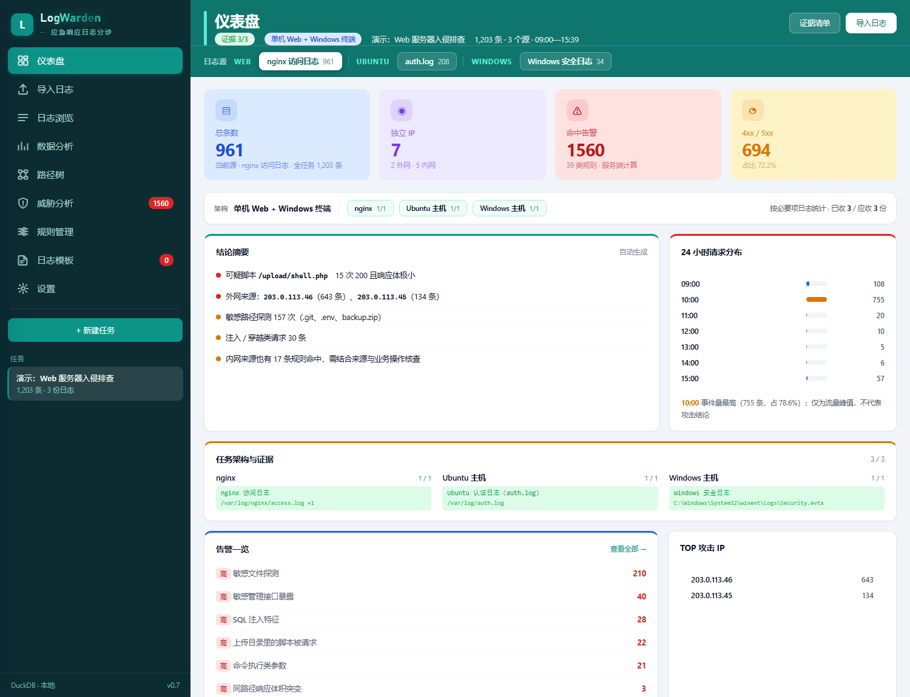
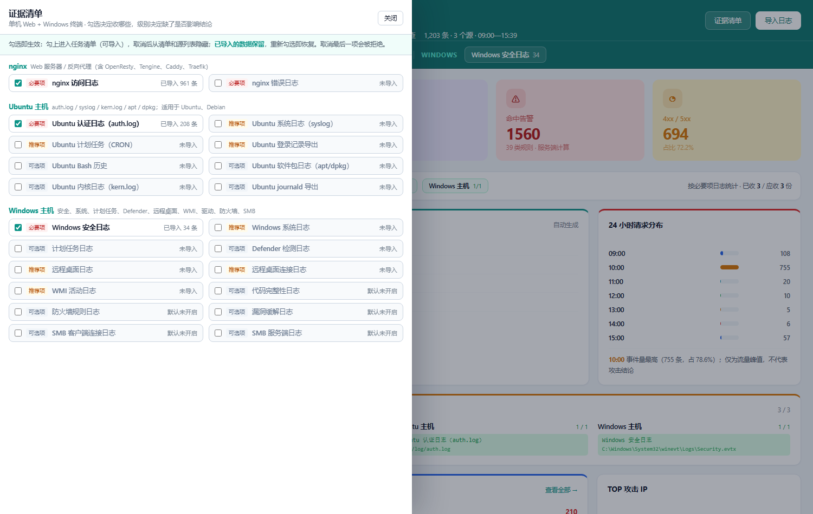
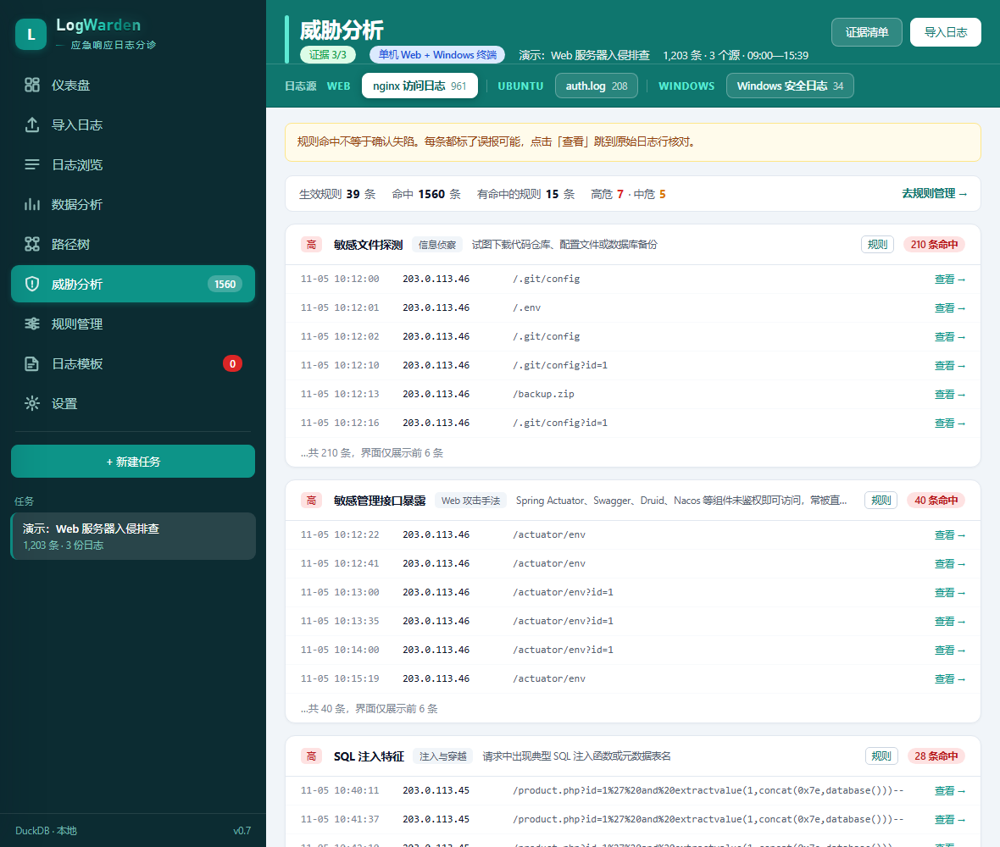
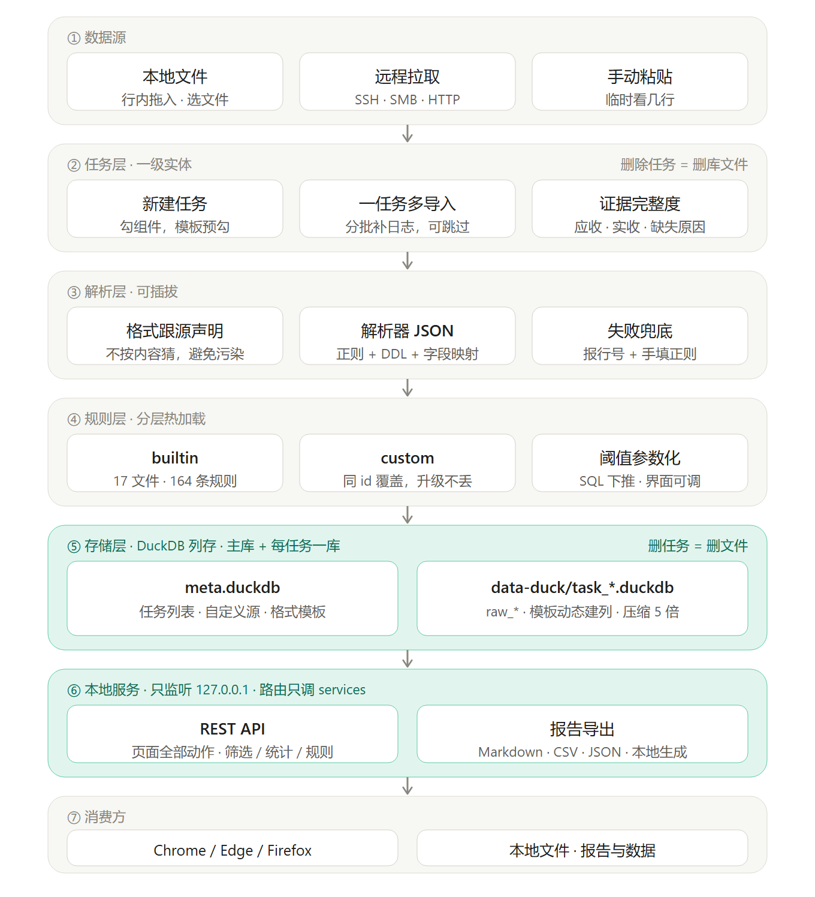
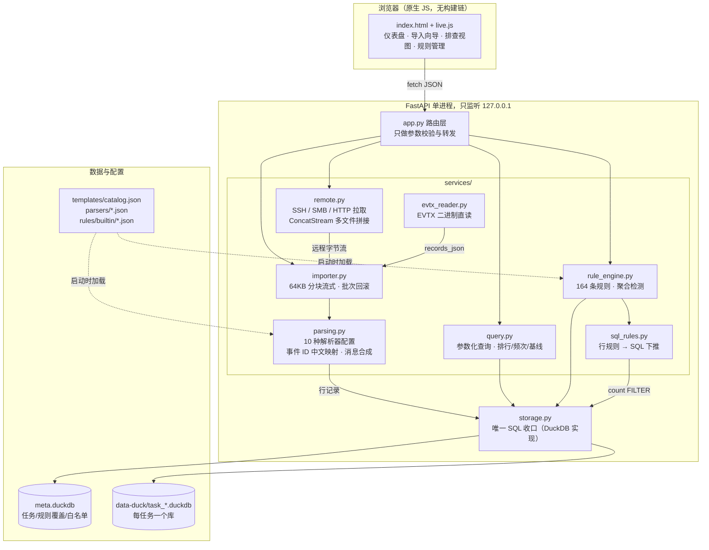
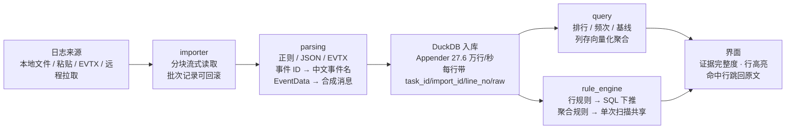

# 🛡 LogWarden — 中文应急响应日志排查工作台

**导入 → 统计出分布 → 筛掉正常 → 规则标出可疑 → 定位可疑行。**

> [!NOTE]
> **LogWarden 是什么**：跑在你自己电脑上的本地日志排查工具。把一台/一组主机的日志（Windows EVTX、nginx、Apache、MySQL、Tomcat、syslog、PowerShell……）导进来，它按「排查组件 → 应收日志 → 证据完整度」的流程带着你走，内置 164 条带误报说明的检测规则，把可疑行直接标出来。
>
> **LogWarden 不是什么**：不是 SIEM，不是 EDR，不做实时采集、不联网、不上传任何数据。它是一把单机放大镜——事后排查、取证、应急响应时用。

- **纯本地**：只监听 `127.0.0.1`，数据全部落在本机 DuckDB 文件，断网可用，适合内网与保密环境；
- **零配置部署**：Python 3.11+ 加一条 `pip install -r requirements.txt`（7 个纯 Python 包，其中 2 个只在用远程拉取时才需要）即可运行，无数据库服务、无消息队列、无前端构建链；
- **中文语境**：31 个组件、66 类日志源的排查清单，160+ 个 Windows 事件 ID 的中文释义，界面、规则、误报说明全中文；
- **大规模可用**：列存 + 向量化聚合，5000 万行 nginx 日志上排行 / 筛选 / 分页全部 0.1 秒内（实测数据见[性能实测](#性能实测)）。

<p align="center">
  
  
  
</p>

---

## 目录

1. [为什么做这个](#1-为什么做这个)
2. [与同类工具的取舍](#2-与同类工具的取舍)
3. [快速开始（5 分钟）](#3-快速开始5-分钟)
4. [核心概念](#4-核心概念)
5. [架构](#5-架构)
6. [功能使用指南](#6-功能使用指南) · [**6.8 AI 操盘与 Skill 手册**](#68-ai-操盘三条通道)
7. [检测规则](#7-检测规则)
8. [性能实测](#8-性能实测)
9. [数据管理与备份](#9-数据管理与备份)
10. [API 一览](#10-api-一览)
11. [目录结构](#11-目录结构)
12. [测试与验证](#12-测试与验证)
13. [已知短板](#13-已知短板)
14. [故障排查](#14-故障排查)
15. [Roadmap](#15-roadmap)
16. [致谢](#16-致谢)

---

## 1. 为什么做这个

应急响应/入侵排查时，手上的日志通常是散的：Windows 给你一堆 `.evtx`，nginx 给你 `access.log` 和轮转文件，数据库给的是另一套格式。现有工具解决两类问题之一：

- **检测引擎**（Hayabusa、Chainsaw、Zircolite）：把 EVTX 丢进去，跑几百条 Sigma 规则，吐出告警。快、准，但它们**不告诉你还该看什么**——没开审计策略的通道、没装的 Sysmon、缺的那半份证据，引擎不会说话；
- **SIEM / 可视化**（LogonTracer 之类）：能力强，但部署动辄 Docker + Neo4j + 一堆依赖，临时接手一台机器根本没有那个环境。

真实排查里最常见的状态是：**人拿着一个日志包，不知道从哪儿开始翻**。LogWarden 就是为这一步做的：

1. **流程带着走**：新建任务时勾选技术栈（nginx / Windows / Sysmon / MySQL……），工具按内置目录列出这类主机**应该收的日志**（必要项 / 推荐项 / 可选项三级），证据完整度实时显示——缺哪块一眼看到；
2. **打开就能读懂**：EVTX 直读，事件 ID 自动带中文释义，EventData 合成成人话（`登录失败 · administrator · 类型 2 · 来源 192.0.2.15 · 进程 chrome.exe`），不用对着 4625 的字段编号猜；
3. **规则给结论也给边界**：每条规则强制写 `false_positive`（误报场景）和 `triage`（下一步怎么查），命中行高亮并跳回原文。

## 2. 与同类工具的取舍

| | LogWarden | Hayabusa | Chainsaw | Zircolite |
|---|---|---|---|---|
| 形态 | 本地 Web 工作台 | CLI 检测引擎 | Rust CLI | CLI（EVTX→SQLite+Sigma） |
| 规则量 | 164 条内置 + 自定义 | 3000+（Sigma 生态） | Sigma / Kusto | Sigma |
| 日志格式 | **多格式统一**：EVTX / nginx / Apache / Tomcat / MySQL / syslog / W3C / 正则自定义 | 仅 Windows 事件日志 | EVTX / JSON | EVTX |
| 排查流程引导 | ✅ 组件→应收日志→证据完整度 | ❌ | ❌ | ❌ |
| 事件 ID 中文释义 | ✅ 160+ | ❌ | ❌ | ❌ |
| 浏览器界面 | ✅（内置，无构建链） | ❌ | ❌ | ❌ |
| AI 操盘 | ✅ **规则与模板都是可读写 JSON + 稳定 API + 每个界面状态有直达 URL** | ❌ 只能读 CLI 输出 | ❌ | ❌ |
| 部署依赖 | pip 7 个包 | 单二进制 | 单二进制 | Python + pip |
| 规则生态 | 小（自建） | **大**（Sigma 全家桶） | 大 | 大 |

一句话：**它们是批量检测引擎，LogWarden 是排查工作台。** 检测能力上不要拿 LogWarden 和 Sigma 生态硬比——164 条比 3000+ 条少一个数量级；但多格式统一入口、证据完整度、中文语境、内置界面，这些是它们没有的。两者完全可以配合：LogWarden 负责把日志收齐、看分布、查上下文，Hayabusa 负责深度检测。

### 为什么它适合交给 AI

多数工具的"AI 集成"是加一个自然语言问答框。LogWarden 走的是另一条路：**把 AI 操盘时的不确定性一条条消掉**。

| AI 的三个痛点 | 这里的做法 |
|---|---|
| **不知道怎么操作界面** | 每个界面状态都有直达 URL：`?nt=1&sel=nginx` 直接弹新建任务、`?evi=1` 打开证据抽屉、`?pg=alerts` 到威胁分析、`#<task_id>` 切任务。不用模拟点击十几次，也不会被动画和懒加载打断。所有动作都有等价的 HTTP 接口 |
| **看不懂规则在干什么** | 164 条规则全是 JSON，字段名、操作符、`false_positive`（误报场景）、`triage`（下一步查什么）都写在文件里。AI 能读、能改、能新增，改完立刻查该源的命中数验证——**不用猜，改错了立刻看得见** |
| **给出的结论没法核实** | 每条告警带命中行 `id`，AI 说「11:23 上传了 webshell」就必须能指回 `id=1234` 那一行原文，人和 AI 看的是同一行。**人能点回去，AI 的话才可信** |

配套有一份操作手册：[`skills/logwarden/SKILL.md`](skills/logwarden/SKILL.md)。API 清单、模板 JSON、规则 JSON、match 语法、scope 取值、六个常见坑都写在里面，任何 AI agent 读完就能上手，不用读代码。

> AI 需要的是更少的不确定性；界面是否更聪明，并不重要。

## 3. 快速开始（5 分钟）

### 环境要求

| 项 | 要求 |
|---|---|
| 操作系统 | Windows / Linux / macOS |
| Python | 3.11+（**便携版不需要**，包内已内置） |
| 浏览器 | Chrome / Edge / Firefox 当前稳定版 |

### 方式一：便携版（Windows，目标机零依赖）

把 [`Releases`](../../releases/latest) 里的 **`logwarden-0.7.0-portable-win64.zip`**（40.8 MB）解压到任意目录，双击 **`启动.vbs`**，浏览器自动打开。

同版本还提供 `.tar.gz`（40.0 MB，体积只小 2%，但 Windows 解压需要 7-Zip / WinRAR，所以默认推荐 zip）。

- `runtime\python\` 里是嵌入式 Python 3.11.9 + 全部依赖（duckdb、fastapi、paramiko、smbprotocol），**目标机不需要装 Python，也不需要联网**；
- 停止服务双击 `停止.vbs`；
- 整个目录可以直接拷到 U 盘或另一台 Windows 机器，路径变了也能跑；
- 首次启动约 3–5 秒（杀软扫描 + DLL 首次加载），之后 1–2 秒。

启动器按 **`runtime\python` → `.venv` → 系统 Python** 三级回退找解释器，任何一级坏掉都会自动往下一级走，不会卡住。

### 方式二：源码运行

```bash
git clone https://github.com/<you>/logwarden.git
cd logwarden

python -m venv .venv

# Windows
.venv\Scripts\python.exe -m pip install -r requirements.txt
.venv\Scripts\python.exe start.py

# Linux / macOS
.venv/bin/python -m pip install -r requirements.txt
.venv/bin/python start.py
```

浏览器会自动打开 `http://127.0.0.1:8766`。

- Windows 下双击 **`启动.vbs`** 可以无窗口后台运行（`停止.vbs` 停止）；
- `--browser none` 只起服务不开浏览器；`--port` 换端口；
- 可选依赖说明：`requirements.txt` 里的 `paramiko` / `smbprotocol` 只在用「远程拉取」的 SSH/SMB 协议时才需要，纯本地导入可以 `pip install` 后手动卸载或注释掉这两行。

### 第一个排查任务

1. **新建任务**：填个名字（如「web 服务器入侵排查」），勾选组件（比如 nginx + Windows），提交；
2. **导入日志**：在「本任务日志清单」里找到对应那一行，把文件或整个文件夹**拖到该行的虚线框**，或点「文件…」选文件——归入哪个日志源在拖的那一刻就定了，不用再选。`.evtx` 直接拖，不用先转 XML；
3. **看分布**：统计面板自动给出 IP 排行、状态码分布、频次异常、基线偏离——先把正常流量看熟；
4. **看告警**：威胁分析页按命中数排序列出规则，点开看命中行，命中行高亮且可跳回原文；
5. **补证据**：点右上角「证据清单」看「已收 / 应收」，缺的日志按提示去目标机开审计或补导，缺哪块一眼看到。

### 示例数据

`sample-data/` 下有一套合成的演练日志，编成一条能讲通的攻击链（**全部使用 RFC 5737 保留地址段与虚构主机名，不含任何真实环境数据**）：

| 文件 | 行数 | 内容 |
|---|---|---|
| `nginx-access.log` | 961 | 正常业务 → 目录扫描 → SQL 注入探测 → webshell 上传 → 命令执行 → 打包下载备份 |
| `linux-auth.log` | 208 | SSH 爆破 → 成功登录 → sudo 提权 → 新建后门账号 |
| `windows-security.csv` | 34 | 28 次 4625 → 4624 成功登录 → PowerShell 编码命令 → 4720 建账号 → 7045 装服务 |

时间线（2026-11-05）：

```
09:00-10:10  正常业务流量（5 个内网客户端）
10:12-10:38  目录扫描 · 203.0.113.46 · 645 次 404
10:40-11:02  SQL 注入探测 · 203.0.113.45 · sqlmap UA
11:23        webshell 上传成功 /upload/shell.php
11:26-13:40  webshell 执行命令（whoami / 读配置 / netstat ...）
14:10-14:16  下载 /data/backup.zip，单次 41-52 MB（外带信号）
10:05-10:36  SSH 爆破 → 10:36 成功 → 10:40 sudo → 11:00 建 svcbackup
11:30-12:26  Windows 侧：4625×28 → 4624 → PowerShell -enc → 建号 → 删号 → 装服务
```

**三步跑完**：新建任务勾 `nginx + Ubuntu 主机 + Windows 主机` → 把三个文件分别拖到对应的清单行 → 看仪表盘结论摘要和威胁分析。预期命中 1595 次，其中高危 7 条。

## 4. 核心概念

```
任务 Task        一次排查 = 一个事件 / 一个站点 / 一组主机
  └ 导入 Import  任务下的一次数据导入，可多次（分批补日志）
      └ 日志源    这份数据属于哪种类型（nginx_access / win_security / auth_log ...）

组件 Component   原子的技术栈单元：nginx / Tomcat / MySQL / Windows / Sysmon / PowerShell ...（31 个）
   └ 日志源      一个组件对应一到多条日志（共 66 条）
                 三级优先：必要项（缺了不能排查）/ 推荐项 / 可选项

模板 Template    常用组合的快捷预设，只是「预勾一组组件」，不是限制（8 个场景）
```

- 任务自带**证据完整度**（已收 / 应收），实时显示在标题栏、仪表盘与证据清单抽屉；
- 日志源是视图最小单位：字段集、统计维度、检测规则、列配置互相独立；
- 界面所有数字实时计算，无模拟常量。

内置 Windows 日志源（12 个）覆盖：Security、System、Defender、RDP（会话 + 认证两个通道）、计划任务、WMI 活动、代码完整性、防火墙规则、安全缓解、SMB 客户端与**服务端**。Linux 源覆盖 syslog、auth.log、pkg 等。

## 5. 架构

### 5.1 总体架构

<p align="center">
  
</p>

七层：**数据源 → 任务层 → 解析层 → 规则层 → 存储层 → 接口层 → 浏览器**。硬约束：**路由不写业务逻辑，所有 SQL 收在 `storage.py` 一个文件里**。



### 5.2 数据流：从日志文件到告警



几个关键设计的动机：

- **每任务一个库文件**：彻底删除 = 删文件，毫秒级且真正擦除；不同任务之间零干扰；
- **表名按格式不按产品**：`raw_evtx`、`nginx_access`……同一格式共享 DDL（DDL 放在解析器配置里），加列走 `SCHEMA_VERSION` 迁移，老数据 `ALTER TABLE` 补齐，**不需要重新导入**；
- **规则下推**（本版特色）：行规则的 `match` 被翻译成 SQL，一次请求一条 `count(*) FILTER (WHERE …)` 多列聚合，30 条规则共享一次数据扫描——27,085 行 Security 日志从 1,969 ms 降到 595 ms，命中数逐条一致（详见 [DESIGN.md](DESIGN.md)）；
- **前端无构建链**：没有 npm、没有打包，`static/` 下三个文件直接改直接生效，二次开发门槛低。

设计文档见 [DESIGN.md](DESIGN.md)（所有取舍的完整论证，唯一事实来源）。

## 6. 功能使用指南

### 6.1 新建任务

勾组件（或点模板预勾）→ 下方按组件列出全部日志源（必要项/推荐项/可选项三级，默认只勾前两级）→ 单条可取消 → 提交后直达导入页。

**证据清单可随时改**：任务页右上角「证据清单」打开左抽屉，按组件列出**该架构下全部可收集的日志源**（不只是已选的），勾选即加入任务、取消即移出，不用重建任务。每行显示级别、是否已导入、导入条数；两列排布，一屏看完。

取消一个已经有数据的源会二次确认——**数据不删除**，只是从清单和源切换条里隐藏，重新勾上原样恢复；最后一个源不允许取消（后端兜底 400）。

### 6.2 导入日志

导入入口就在「本任务日志清单」的每一行，对着哪个源导就拖到哪一行：

| 方式 | 用法 | 说明 |
|---|---|---|
| 拖入导入 | 把文件或整个文件夹拖到该行左侧虚线框 | 文件夹递归收集，非日志文件（docx/图片）、隐藏文件和超过 500MB 的自动跳过 |
| 选择文件导入 | 点该行右侧「选择文件导入」，弹系统原生对话框 | 可多选 |

清单只列**当前任务勾选的源**——缺源先去「证据清单」抽屉勾上。格式跟着日志源走（`nginx_access` 用 combined、`win_security` 用 evtx/windows_event），编码在清单标题栏切换（UTF-8 / GBK）。

另外两个入口在页签里：

| 来源 | 用法 | 限制 |
|---|---|---|
| 粘贴文本 | 直接粘，选好源提交 | 单次 ≤ 5000 行 |
| 远程拉取 | SSH/SFTP · SMB · HTTP(S)，探测后按块流式拉取，可取消 | 目标机需开放对应服务 |

要点：**格式跟日志源声明走，不按内容猜**（有意为之，误判会污染整个任务）；不确定先「预览」，坏行带行号报出；可分批补导；**导入错了在导入历史里回滚**，整批删掉该次写入的行。

### 6.3 远程拉取

切到「远程拉取」页签 → 选协议 → 填主机、账号、认证方式、远端路径 → **先点「测试连通」**。探测返回文件个数、总大小、估算行数和前几行样本——**先看清楚再决定拉不拉**。确认后「开始拉取」，后台按块流式导入，进度条显示当前文件与百分比，随时可取消。

| | SSH/SFTP | SMB | HTTP(S) |
|---|---|---|---|
| 适用 | Linux 服务器 `/var/log` | Windows 主机 `C$\...` | 暴露的日志端点 |
| 通配 | `access.log-*` 展开轮转文件 | 支持 | 不支持 |
| 压缩 | `.gz` 就地解压，不用先解压再传 | 同左 | 同左 |
| 凭据 | 密码 / 私钥（文本或文件），只在本次连接使用，不落盘 | 用户名/密码 | Basic |

细节：多文件按修改时间从旧到新拼成一条导入记录；SSH 首次连接记录主机指纹，之后指纹变了直接拒绝（TOFU 防中间人）；目标机侧的准备方法——Windows 机 SMB 服务端默认开着，用管理员账号 + `C:\Windows\...` 路径即可；Linux 机需安装 samba 并配置只读共享。

### 6.4 浏览与筛选

日志源切换条默认只列有数据的源；Excel 式列筛选（按选项/按条件，点确定才生效）；顶部快捷排除开关；JSON 条件查询（正则只在后端跑）；列配置按源独立记忆；单元格单击即复制；表头吸顶；游标分页；规则命中的行高亮且只染命中字符。

### 6.5 统计面板

概览 / 排行（不限条数，次数⇄字节可切）/ 频次分析（滑动窗口）/ 基线分析（count·avg·p95）四类，维度随日志源自动变化，全部后端 SQL 计算。**这是 DuckDB 列存的优势区**——5000 万行数据上排行、独立值、分页全部 0.1 秒内。

### 6.6 威胁分析与任务管理

- 威胁分析页：规则按命中数降序，命中行可跳回原文；与规则管理页同源，禁用立即生效；
- 任务管理：软删除可恢复；彻底删除直接删库文件，毫秒级。

### 6.7 自定义格式与日志源

- **格式模板**（`formats/` 落盘）：`kind="nginx"` 整段 log_format 自动编译正则；`kind="regex"` 命名捕获组即字段。语义字段（`ip/ts/method/path/status/bytes/ua/...`）进下游统计与规则，其余字段各建一列。支持粘样例实时预览、一行日志自动识别厂商生成草稿；
- **自定义日志源**（`sources/` 落盘）：起名 + 选解析器 + 挂组件，启动时与内置目录合并。ID 规则 `^[a-z][a-z0-9_]{2,31}$`。

### 6.8 AI 操盘：三条通道

优先级是 **API > CDP > 读库**。其中模拟点击是最慢、最不稳定的一种。

| 通道 | 适用 | 入口 |
|---|---|---|
| **HTTP API**（首选） | 建任务、导日志、查统计、读告警、改规则、改模板——全部动作 | `http://127.0.0.1:8766/api/docs` |
| **CDP**（需要人同步看到界面时） | 带调试端口的独立浏览器，agent 直连操作 | `--remote-debugging-port=9223` |
| **只读**（服务没起时） | 直接读任务库做离线分析 | `data-duck/task_*.duckdb` |

**给 AI agent 的操作手册**：[`skills/logwarden/SKILL.md`](skills/logwarden/SKILL.md)——API 速查、模板 JSON 结构、规则 match 语法、scope 取值、六个常见坑，读完就能上手，不需要读代码。

**为什么 API 优先**：界面的每一次点击都可能被动画、懒加载、缓存状态影响，API 调用则是原子的；模板和规则本来就是 JSON，走接口一步改完，走界面要点五层菜单。

CDP 通道怎么用：服务启动时用 `--remote-debugging-port=9223` 拉起独立配置的浏览器，**任何支持 Chrome DevTools Protocol 的 agent（Playwright、browser-use、各类 agent 框架）都能直连**，像人一样操作整个界面——切任务、切源、筛选、翻页、读证据、触发导出。AI 看到的是同一个界面、同一份 DOM，不需要为它开发专用接口。

```python
# pip install playwright && playwright install chromium
from playwright.sync_api import sync_playwright

with sync_playwright() as p:
    browser = p.chromium.connect_over_cdp("http://127.0.0.1:9223")
    page = [c for c in browser.contexts[0].pages if "8766" in c.url][0]
    page.goto("http://127.0.0.1:8766/?pg=alerts#<task_id>")   # 直达优先，点击次之
```

可运行的完整示例见 [`examples/cdp_demo.py`](examples/cdp_demo.py)。

## 7. 检测规则

164 条内置规则（`rules/builtin/` 17 个文件），覆盖 Web 攻击、扫描器、Webshell、主机入侵、Windows 攻击链（认证 / 横向 / 权限提升 / 隐匿 / WMI 无文件持久化 / BYOVD 驱动加载）、数据库攻击、容器与 Linux 持久化。

- 两类规则：`row` 单行匹配 / `aggregate` 聚合（滑动窗口计数、失败后成功等时序模式）；
- 每条规则强制携带 `false_positive`（误报场景）与 `triage`（下一步怎么查），并进单元测试——**每条规则都有能命中的样本**，规则写错只会静默 0 命中，比没有规则更危险；
- 规则 JSON 支持阈值参数化（`params`）、`scope` 按日志源限定、`any/not` 逻辑组合；
- 按文件 mtime 自动重载；管理界面卡片式，内置规则只能改元信息，删除两步确认；
- `rules/custom/` 同 id 覆盖内置规则，你的修改不会被升级冲掉。

写一条规则：

```json
{
  "id": "win_wmi_permanent_subscription",
  "name": "WMI 永久事件订阅（无文件持久化）",
  "severity": "high",
  "kind": "row",
  "scope": "win",
  "match": { "eventId": { "eq": 5861 } },
  "explain": "注册了常驻 WMI 事件消费者，属于无文件持久化（T1546.003）",
  "false_positive": "部分运维/监控软件也会用，核对 Consumer 类型与命令行",
  "triage": "取 Consumer 名称与 Query，查命令行指向的可执行文件是否落盘",
  "attack": ["T1546.003"]
}
```

## 8. 性能实测

5000 万行 nginx access 日志，8 线程导入：

| 操作 | 耗时 |
|---|---|
| 导入（真实解析链路） | 137 s（36.6 万行/秒；单线程 4.6–4.9 万行/秒） |
| 库大小 | 2.7 GB |
| COUNT / MIN / MAX | 0.01 s |
| IP 排行 TOP20 | 0.09 s |
| 独立路径数 | 0.04 s |
| 404 筛选分页 | 0.01 s |
| 分钟峰值 | 0.10 s |

告警（30 条行规则 + 2 条聚合规则，27,085 行 EVTX）：

| 实现 | 耗时 | 内存 |
|---|---|---|
| 整表物化 + Python 逐行正则 | 1,969 ms | 1000 万行约 19 GB |
| 规则下推 SQL | **595 ms** | 与行数无关 |

Windows 字段提取（`win_security` 27,085 行，EVTX 本身不存渲染后消息）：

| 字段 | 提取前 | 提取后 |
|---|---|---|
| `msg` 消息 | 0.3% | **99.9%** |
| `image` 进程 | 0.3% | **52.3%** |
| `sid` / `detail` | — | **99.9%** |

## 9. 数据管理与备份

```
logwarden/
├── meta.duckdb          主库：任务列表、规则覆盖、白名单、保存的视图
├── meta.duckdb.wal      WAL 临时文件，正常关闭后合并
└── data-duck/
    ├── task_xxxx.duckdb     每任务一个库
    └── task_xxxx.duckdb.wal
```

- **备份**：`meta.duckdb` 必须单独备份（丢了它数据文件就成了无名文件）；保留的任务拷走对应 `data-duck/task_*.duckdb`；**拷贝前先停服务**——DuckDB 的 WAL 在进程存活时可能未合并；
- 数据根目录可用环境变量 `LOGVIEW_DATA_DIR` 改到别处；
- 彻底删除任务 = 删文件，毫秒级且真正擦除。

## 10. API 一览

交互式文档：**`http://127.0.0.1:8766/api/docs`**（Swagger UI）。

| 方法 | 路径 | 用途 |
|---|---|---|
| GET | `/api/health` | 健康检查 |
| GET | `/api/bootstrap` | 前端初始化数据（组件/源/模板） |
| GET / POST | `/api/tasks` | 任务列表 / 新建 |
| GET / DELETE | `/api/tasks/{id}` | 详情 / 删除（`?permanent=true` 彻底删除） |
| POST | `/api/tasks/{id}/restore` | 恢复软删除 |
| GET / POST | `/api/tasks/{id}/imports` | 导入历史 / 上传文件 |
| POST | `/api/tasks/{id}/imports/text` | 粘贴导入 |
| DELETE | `/api/tasks/{id}/imports/{import_id}` | 回滚一次导入 |
| POST | `/api/tasks/{id}/query` | 参数化查询 |
| GET | `/api/tasks/{id}/sources/{source}/stats` | 统计 |
| GET | `/api/tasks/{id}/sources/{source}/alerts` | 告警 |
| POST | `/api/remote/probe` | 远程连通性探测 |
| POST / GET | `/api/remote/pull` / `/api/remote/jobs/{id}` | 发起拉取 / 进度查询 |
| POST | `/api/preview` | 导入前预览 |
| GET/POST/DELETE | `/api/formats*` | 格式模板 CRUD / 预览 / 识别 |
| GET/POST/DELETE | `/api/sources/custom*` | 自定义源 CRUD |
| GET/POST/PUT/DELETE | `/api/rules*` | 规则 CRUD / 错误清单 / 试跑 |

约定：`ValueError` → 400，`KeyError` → 404，统一安全响应头。

## 11. 目录结构

```
logwarden/
├── app.py               FastAPI 入口
├── start.py             启动器（自动开浏览器，可 --browser none）
├── storage.py           DuckDB 存储实现（唯一 SQL 收口）
├── parsers/             9 个解析器配置（DDL、字段映射）
├── templates/           catalog.json（31 组件 + 66 源）+ 8 个场景模板
├── rules/               builtin 18 文件 164 条 + custom 同 id 覆盖
├── sources/ formats/    自定义源 / 自定义格式落盘
├── runtime/             运行期目录（首次启动自动生成）
│   ├── python/          便携版自带的嵌入式 Python 3.11.9 + 全部依赖
│   │                    （源码版没有此目录，走 .venv 或系统 Python）
│   ├── browser-*/       调试浏览器的独立配置，删掉会重建
│   └── server.log       后端日志，启动失败先看这里
├── data-duck/           任务库（每个任务一个 .duckdb，自动生成，删掉即清空）
├── services/
│   ├── importer.py      流式导入 · 批次回滚
│   ├── parsing.py       10 种格式解析 · EVTX 消息合成 · 事件 ID 中文映射
│   ├── evtx_reader.py   EVTX 二进制直读
│   ├── remote.py        SSH/SMB/HTTP 拉取 · ConcatStream 多文件拼接
│   ├── query.py         参数化查询 · 统计聚合
│   ├── rule_engine.py   检测规则执行（行规则 SQL 下推 + Python 兜底）
│   ├── sql_rules.py     规则 → SQL 翻译
│   ├── web_format.py    nginx log_format / 自定义正则编译
│   └── custom_sources.py 自定义日志源
├── static/              前端（index.html + live.js，无构建链）
├── tests/               8 个测试文件，168 组用例
├── docs/                架构图与界面截图
├── sample-data/         演练日志（nginx / auth / Windows 事件，可直接跑通全流程）
├── skills/logwarden/    给 AI agent 的操作手册（API、模板、规则、常见坑）
├── examples/            AI 操盘示例（CDP）
├── 启动.vbs / 停止.vbs  Windows 无窗口启停
└── DESIGN.md            设计文档（所有取舍的完整论证）
```

## 12. 测试与验证

```bash
.venv/bin/python -m unittest discover -s tests
```

不依赖 pytest，`unittest` 直接跑。

- **168 组用例**：解析器回归（含真实 Windows 日志样本）、规则命中样本（每条规则都有）、规则下推与 Python 判断的一致性对照、远程拉取端到端（本地 HTTP 全链路）、ConcatStream 拼接/取消/跳过、连接池引用计数、非 ID 列排序翻页（含 NULL 行）；
- **一致性对拍**：同一批日志分别走 DuckDB 版与 SQLite 版，逐项比对行数、时间范围、独立值、IP 排行、频次判定、基线、告警命中、列名与类型——结果完全一致。

## 13. 已知短板

- **聚合规则仍有 Python 侧开销**：行规则已下推 SQL，但聚合规则（滑动窗口、失败后成功）需流式扫全表，1000 万行约 20–40 秒——不会 OOM，但不是秒级；
- **频次分析与基线分析**是 Python 流式遍历，5000 万行各约 50 秒；
- **DuckDB 单进程写**：同一库文件第二个写进程会报错，不能起多 worker；单机单用户不受影响；
- **规则生态小**：164 条内置 vs Sigma 生态的数千条。自建规则语法简单，欢迎贡献；
- **DuckDB 打开库有元数据读取成本**，**不适合频繁开关几十行的小任务**；
- **便携版解压后约 110 MB**：嵌入式 Python 21 MB + 依赖 87 MB，其中 duckdb 的单个 C++ 扩展 `.pyd` 就 41 MB（官方 wheel 未 strip 调试符号）。压缩后约 40 MB。纯源码版只有 1.6 MB。

## 14. 故障排查

| 现象 | 处理 |
|---|---|
| 端口被占 | `python start.py --port 9000` 换端口 |
| `Could not set lock on file` | 同一库文件被第二个进程打开——关掉另一个实例 |
| 导入后查不到数据 | 检查导入时的日志源与格式；导入历史回滚后重选再导 |
| 解析失败带行号 | 格式与解析器不匹配，去「日志格式」页新建模板 |
| 规则命中 0 怀疑规则坏了 | 「规则测试」粘样本；`GET /api/rules/errors` 看加载失败清单 |
| 浏览器没自动打开 | `--browser none` 后手动访问 `http://127.0.0.1:8766` |
| EVTX 导入报错 | 确认文件没被占用/加锁（某些工具会独占锁文件）；拷贝一份再导 |

## 15. Roadmap

- [ ] 定时任务与增量检测（`since_id` 水位线）
- [ ] **Sigma 规则导入**：用 pySigma 作离线编译器，把 Sigma YAML 转成本项目的 JSON 规则——规则仍可在页面编辑，运行时不需要 pySigma。先决条件有三：字段映射（`Image→image`、`CommandLine→cmdline`、`ParentImage→parent`）、大小写语义对齐（Sigma 默认不区分，本项目的 `eq` 区分）、logsource→日志源映射表。**覆盖范围限于 Windows 事件与 Sysmon**，nginx / 防火墙 / 数据库那几类源 Sigma 本身就没有规则
- [ ] 英文界面
- [ ] SQLite 存储变体（几十万行小任务的轻量档）
- [ ] 告警白名单与 suppressed 规则视图

## 16. 致谢

- [DuckDB](https://duckdb.org/) — 列存引擎，本工具性能的地基
- [evtx](https://github.com/omerbenamram/evtx) — Rust 实现的 EVTX 解析
- [paramiko](https://www.paramiko.org/) / [smbprotocol](https://github.com/jborean93/smbprotocol) — 远程拉取
- [MITRE ATT&CK](https://attack.mitre.org/) — 规则的攻击技术编号体系
- [Sigma](https://github.com/SigmaHQ/sigma) — 规则生态的参照系

---

## License

[MIT](LICENSE) © LogWarden contributors

*本工具仅用于对自有或经授权的资产进行安全排查与取证，请勿用于未授权环境。*
